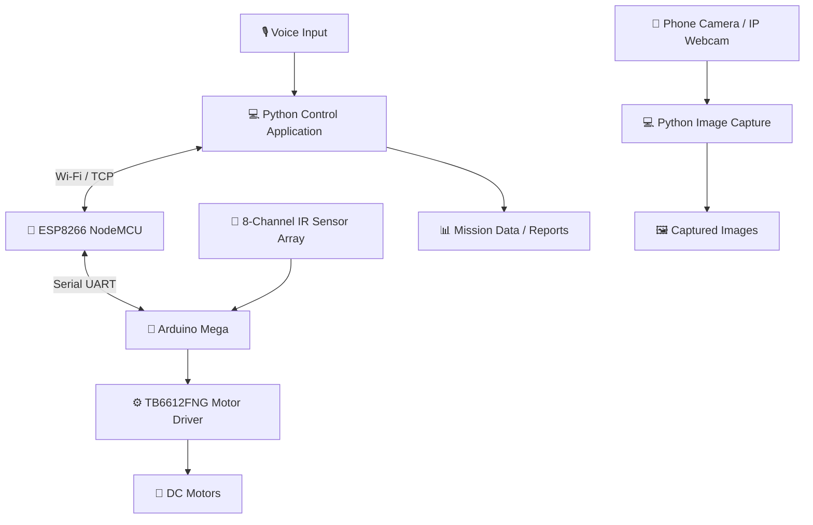

# 🤖 TrackForge
### Wireless Voice-Controlled Autonomous Line-Following Robot with Camera-Based Data Capture

<p align="center">
  
  
  
  
</p>

<p align="center">
  <b>Speak to your robot. Control its movement wirelessly. Capture mission data.</b>
</p>

---

## 📌 Overview

**TrackForge** is a robotics project that integrates autonomous line following, wireless communication, voice-based movement control, and camera-based image capture into a single robotic platform.

The robot follows a line using an array of infrared sensors and an Arduino Mega-based controller. An ESP8266 provides a wireless communication bridge, allowing a Python application running on a computer to send commands over Wi-Fi.

A phone camera running an IP Webcam application can provide images for capture and storage by the computer.

### ✨ Key Features

- 🛣️ **Autonomous line following** using an 8-channel analog IR sensor array.
- 🎙️ **Voice-controlled operation** through a Python desktop application.
- 📡 **Wireless communication** between the computer, ESP8266, and Arduino Mega.
- ↪️ **Directional rotation commands** for rotating left and right.
- 🛑 **Stop and emergency-stop voice commands.**
- 📷 **Camera-based image capture** using a phone camera stream.
- 💾 **Mission data handling** through the desktop application.
- 🔋 **Standalone robot operation** using a battery-powered robot platform.
- 🧩 **Modular architecture** with separate computer software and microcontroller firmware.

> **Project scope:** Voice recognition and camera handling run on the computer. The ESP8266 acts as a communication bridge, while the Arduino Mega controls the robot. Onboard AI vision and autonomous object recognition are not claimed features of the current version.

---

## 🏗️ System Architecture



### 🔄 How It Works

1. The Python application listens for voice input.
2. Recognized voice commands are converted into robot-control messages.
3. The computer sends commands over Wi-Fi using TCP.
4. The ESP8266 forwards commands to the Arduino Mega through serial communication.
5. The Arduino manages line following, movement, and directional rotation.
6. When requested, the computer can capture images from the phone camera stream and save mission-related data.

---

## 🧰 Hardware Requirements

| Component | Purpose |
|---|---|
| Arduino Mega Mini Pro (ATmega2560) | Main robot controller |
| ESP8266 NodeMCU | Wireless communication bridge |
| 8-channel analog IR sensor array | Line detection |
| TB6612FNG motor driver | DC motor control |
| 2 × DC motors | Robot movement |
| 3S LiPo battery | Robot power supply |
| Phone with IP Webcam | Camera-based image capture |
| Computer or laptop | Voice recognition, wireless commands, and image storage |
| Chassis, wheels, and wiring | Robot assembly |

### 💻 Software Requirements

- Python 3.10.x — tested with Python 3.10.9
- Arduino IDE
- Arduino Mega board support
- ESP8266 board support for Arduino IDE
- Python packages:
  - `SpeechRecognition`
  - `pyttsx3`
  - `requests`
  - `PyAudio`
- IP Webcam application on the phone
- A shared Wi-Fi network for the computer and ESP8266

---

## 📁 Project Structure

```text
Operation1122/
│
├── captain/
│   └── operation1122_voice.py
│
├── esp8266_server/
│   └── esp8266_server.ino
│
├── mega_controller/
│   └── mega_controller.ino
│
├── README.md
├── requirements.txt
└── .gitignore
```

### Module Responsibilities

| File | Responsibility |
|---|---|
| `captain/operation1122_voice.py` | Voice recognition, spoken feedback, wireless commands, and camera/data operations |
| `esp8266_server/esp8266_server.ino` | Wi-Fi connection and TCP-to-serial communication bridge |
| `mega_controller/mega_controller.ino` | Robot movement and line-following control |
| `requirements.txt` | Python dependency list |
| `.gitignore` | Excludes local configuration, environments, backups, and generated files |

*The `requirements.txt` file should be present in the repository before using the corresponding installation command below.*

---

## 🚀 Getting Started

### 1. Clone the Repository

Open PowerShell or a terminal:

```powershell
git clone https://github.com/RaiyyanAlif/TrackForge.git
cd TrackForge
```

### 2. Create a Python Virtual Environment

On Windows:

```powershell
py -3.10 -m venv .venv
.\.venv\Scripts\Activate.ps1
```

If PowerShell blocks environment activation, use the virtual environment's Python executable directly:

```powershell
.\.venv\Scripts\python.exe --version
```

### 3. Install Python Dependencies

If `requirements.txt` exists:

```powershell
python -m pip install --upgrade pip
python -m pip install -r requirements.txt
```

If the file has not been created yet, install the known dependencies:

```powershell
python -m pip install SpeechRecognition pyttsx3 requests PyAudio
```

**Note:** PyAudio installation may depend on your Python version and Windows environment. Resolve any installation error before launching the application.

### 4. Configure the ESP8266

1. Open `esp8266_server/esp8266_server.ino` in Arduino IDE.
2. Configure the Wi-Fi credentials for your network.
3. Ensure the TCP server port matches the Python application. The project uses port `8266`.
4. Select the appropriate ESP8266 board and COM port.
5. Compile and upload the firmware.
6. Confirm the ESP8266 connects to Wi-Fi and note its assigned IP address.

Update the IP address in the Python application if the ESP8266's address changes.

> **Security:** Never commit Wi-Fi passwords, API keys, or private credentials to a public repository. Prefer local configuration or environment variables.

### 5. Configure the Arduino Mega

1. Open `mega_controller/mega_controller.ino`.
2. Select the appropriate Arduino Mega/ATmega2560 board configuration.
3. Verify the serial communication settings match the ESP8266 firmware.
4. Verify sensor and motor-driver pin assignments against your actual wiring.
5. Compile and upload the firmware to the Arduino Mega.

### 6. Configure the Phone Camera

1. Connect your phone and computer to the same network.
2. Launch the IP Webcam application on your phone.
3. Start its camera server.
4. Identify the image or video stream URL provided by the application.
5. Update the camera URL in the Python application to match your phone's current address and stream endpoint.

Keep the phone and computer connected to the network while using camera-based capture.

### 7. Run TrackForge

From the project root:

```powershell
python .\captain\operation1122_voice.py
```

Wait for the application to initialize, then use the supported voice commands listed below.

---

## 🎙️ Voice Command Reference

TrackForge supports voice commands for status checks, line following, directional rotation, stopping, and camera/data operations.

| Voice command | Action |
|---|---|
| `Do you copy` | Request robot status |
| `Captain` | Request robot status |
| `Status` | Request robot status |
| `How is the robot` | Request robot status |
| `Start following` | Start or resume line following |
| `Continue following` | Resume line following |
| `Resume following` | Resume line following |
| `Rotate left` | Rotate the robot left |
| `Rotate right` | Rotate the robot right |
| `Stop now` | Stop the robot |
| `Stop robot` | Stop the robot |
| `Halt` | Stop the robot |
| `Emergency stop` | Stop the robot |
| `Capture data` | Trigger the configured camera-capture operation |
| `Take a picture` | Trigger the configured camera-capture operation |
| `Send data` | Request mission-data/report handling |
| `Save mission data` | Request mission-data/report handling |

### 🎯 Movement Control

- **Start following:** Activates line-following behavior.
- **Rotate left:** Requests a left rotation.
- **Rotate right:** Requests a right rotation.
- **Stop / Halt:** Stops robot movement.

The exact rotation duration, turning behavior, and return-to-line behavior depend on the current firmware implementation and configured control logic.

Voice recognition may vary with microphone quality, background noise, and speech-recognition results. Use the command phrases implemented in the current Python application.

---

## 📡 Communication Protocol

TrackForge uses a computer-to-ESP8266 TCP connection and a serial connection between the ESP8266 and Arduino Mega.

```text
Python Application
       |
       | Wi-Fi / TCP, port 8266
       v
ESP8266 NodeMCU
       |
       | Serial UART
       v
Arduino Mega
       |
       v
Motor Driver and Robot
```

### Communication Details

| Parameter | Configuration |
|---|---|
| Network transport | TCP over Wi-Fi |
| ESP8266 server port | `8266` |
| Message format | Newline-terminated commands |
| Controller link | Serial UART |
| Example response observed during testing | `ACK:STATUS:STOPPED` |

The exact command tokens and UART baud rate must match the firmware and Python application. Refer to the source files when modifying the communication protocol.

---

## 📷 Camera-Based Data Capture

TrackForge can use a phone as a wireless camera through an IP Webcam application.

The computer handles image capture and storage. This makes it possible to collect visual data during robot experiments without requiring a dedicated camera module connected directly to the Arduino.

### Typical Workflow

1. Start the phone's IP Webcam server.
2. Verify that the camera stream is accessible from the computer.
3. Start the Python control application.
4. Use a supported image-capture command.
5. Verify that the image was saved at the location configured in the Python script.

**Important:** The phone camera is a data-capture component. Camera-based object detection, lane recognition from images, and onboard computer vision are not claimed features of the current version.

---

## 🔋 Power and Safety

- Use a suitable battery and verify polarity before powering the robot.
- Check that the TB6612FNG motor driver's voltage and current ratings are appropriate for the motors.
- Follow the correct logic-voltage requirements for the ESP8266 and Arduino Mega serial connection.
- Establish a common ground between interconnected electronics where required by the circuit.
- Use suitable voltage conversion or level shifting for serial signals where necessary; ESP8266 GPIO pins are not 5 V tolerant.
- Test motor movement with the wheels lifted off the ground before running the robot on a track.
- Keep a physical way to disconnect motor power during testing.
- Do not treat a software voice command as a guaranteed hardware emergency stop.

---

## 🛠️ Troubleshooting

<details>
<summary><b>Python cannot connect to the ESP8266</b></summary>

- Check that both devices are connected to the same network.
- Verify the ESP8266 IP address in the Python script.
- Confirm that TCP port `8266` matches the firmware configuration.
- Check firewall rules and confirm that the ESP8266 server has started.

</details>

<details>
<summary><b>Voice commands are not recognized</b></summary>

- Confirm that a working microphone is selected.
- Reduce background noise.
- Verify that PyAudio and SpeechRecognition are installed.
- Speak clearly and use a supported phrase from the command table.

</details>

<details>
<summary><b>The robot does not follow the line</b></summary>

- Confirm that the IR sensor array is positioned correctly.
- Test each sensor on black and white surfaces.
- Verify the sensor pin mapping and calibration logic.
- Check the motor-driver wiring and motor direction.
- Inspect the line-following logic and control parameters in the Mega firmware.

</details>

<details>
<summary><b>Rotate left or Rotate right does not work</b></summary>

- Confirm that the voice-control application recognizes the phrase.
- Check that the ESP8266 forwards the command correctly.
- Verify that the Arduino firmware implements the matching command.
- Check motor direction, wiring, and power supply.
- Review the rotation timing and movement logic in the current firmware.

</details>

<details>
<summary><b>Camera capture fails</b></summary>

- Confirm that the IP Webcam server is running.
- Verify the stream URL from the computer.
- Check that the phone's IP address has not changed.
- Confirm that the destination folder exists and is writable.

</details>

<details>
<summary><b>The Arduino or ESP8266 does not compile</b></summary>

- Confirm that the correct board is selected.
- Install the required board support package.
- Check the selected serial pins and firmware configuration.
- Review the compiler error for missing libraries or syntax problems.

</details>

---

## 🗺️ Roadmap

Potential improvements for future versions:

- [ ] Add a documented and configurable pin-mapping table.
- [ ] Add a complete wiring diagram.
- [ ] Improve Wi-Fi reconnection and communication error handling.
- [ ] Add a more robust command acknowledgment and timeout mechanism.
- [ ] Add structured mission logs with timestamps.
- [ ] Improve camera capture organization and metadata handling.
- [ ] Add configurable motor and line-following parameters.
- [ ] Add automated tests for command parsing and communication.
- [ ] Explore computer vision and AI-based perception as a separate future feature.

---

## 🤝 Contributing

Contributions, bug reports, testing feedback, and improvement ideas are welcome.

1. Fork the repository.
2. Create a feature branch.
3. Make and test your changes.
4. Commit your changes with a descriptive message.
5. Open a pull request explaining the changes.

Please avoid committing private configuration files, generated datasets, credentials, or local environment folders.

---

## 📜 License

No license has been specified yet. Until a license is added to the repository, do not assume that the code is available for unrestricted reuse, modification, or redistribution.

---

## 👨‍💻 Project Repository

**TrackForge — Wireless Voice-Controlled Autonomous Line-Following Robot with Camera-Based Data Capture**

- Repository: https://github.com/RaiyyanAlif/TrackForge

<p align="center">
  <b>Built with curiosity, code, and robotics. 🤖</b>
</p>
